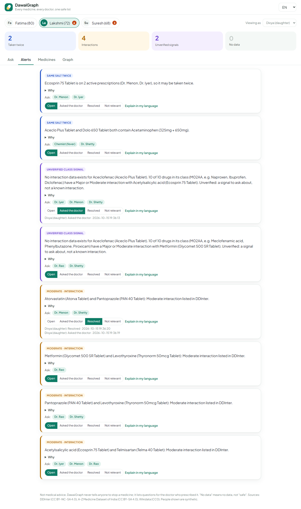
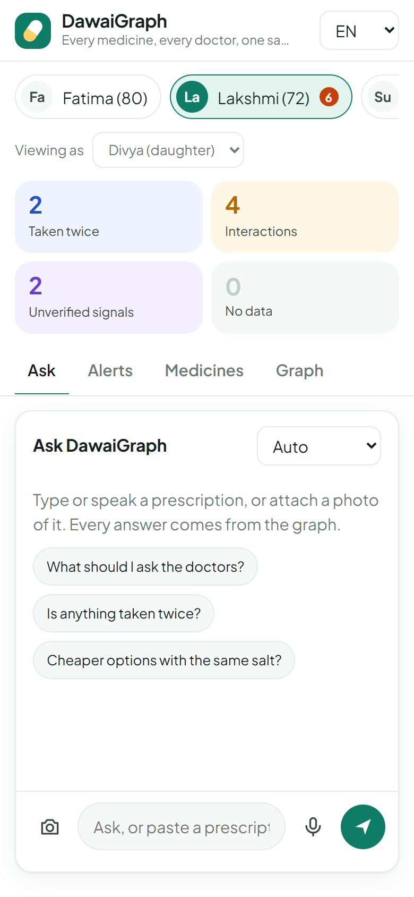
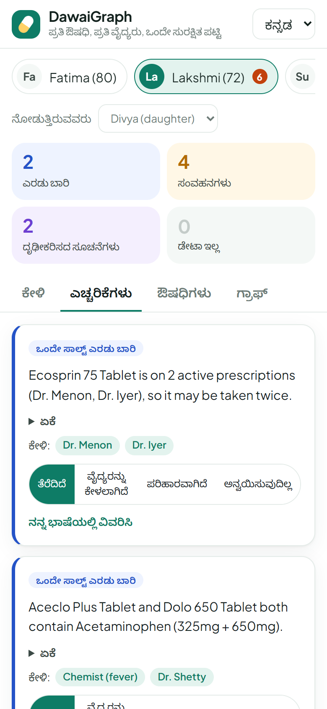

# DawaiGraph

**One list of everything an elderly parent takes, across every doctor and every brand name, checked on a FalkorDB graph.**

Built for Graph Hacks (WeMakeDevs x FalkorDB, 15-18 Oct 2026). Tracks: **Agents That Act on Connected Data** and **Agent Memory and Coordination**.

**Live:** https://dawaigraph-1037019152152.asia-south1.run.app (each browser gets its own private copy of three synthetic families; "Reset demo data" at the bottom puts yours back)

What a carer can do:
- Type, **speak** (the browser's own speech-to-text) or **photograph** a prescription; the agent reads it, resolves each brand in the graph and asks when a brand is unclear or missing.
- Ask in **their own language**: the agent replies in the language and script it is asked in (Hindi, Kannada, Tamil, Telugu, Malayalam, Marathi, Bengali, Gujarati, Punjabi, Odia, Urdu, English, Hinglish). The interface itself is in English, Hindi and Kannada.
- See the same salt twice (including one brand from two doctors), interactions, unverified class signals and "no data", each with the graph path and the doctors to ask.
- Mark a finding "asked the doctor" so the rest of the family sees it, and print a **doctor visit sheet**: one checklist per doctor for the next appointment.
- Use the graph from any AI assistant through the read-only **MCP server**.
- Open **"How I got this"** under any answer: every graph step the agent took, the Cypher it ran and what came back, so each decision can be traced.
- Ask **"why are these two medicines connected?"**: the agent runs a shortest-path search over the person's medicines and shows every hop, including links that only exist through a third medicine.
- Trust the names: every medicine named in an answer is checked against what the graph returned in that conversation (see [Guards](#guards)).



| Ask (phone) | Alerts in Kannada |
|---|---|
|  |  |

## The problem

In India an elderly parent often sees three or four doctors (a GP, a cardiologist, an orthopaedic surgeon, a dentist) plus the chemist. Each one prescribes by **brand name**, and nobody holds the full list. Two failures follow:

1. **The same salt twice.** Aceclo Plus (for knee pain) and Dolo 650 (for fever) both contain paracetamol. The names share nothing.
2. **Interactions across doctors.** The dentist's painkiller meets the cardiologist's warfarin.

There is a third, quieter failure. The open interaction data the world uses (DDInter) is built around drugs sold in the US and Europe. Many of the salts Indians take every day, such as **aceclofenac, nimesulide, etoricoxib, gliclazide, vildagliptin and domperidone**, have **no interaction data at all**. A plain lookup returns nothing, and "nothing found" looks like "safe".

## Why a graph

- Brands carry no meaning. "Dolo 650" and "Aceclo Plus" are unrelated strings that share a salt: a two-hop pattern `Brand-[:CONTAINS]->Salt<-[:CONTAINS]-Brand`. Vector similarity cannot find that.
- Interactions are between **salts**, people hold **brands**, and combination pills hold several salts. "Do any two of these eight brands interact?" is one pattern, `Brand->Salt-[:INTERACTS]-Salt<-Brand`, and the path it returns is the explanation.
- **Filling the data gap is graph reasoning.** For a salt with no data, DawaiGraph walks to its drug class and looks at the class siblings that do have data: `Brand->Salt-[:IN_CLASS]->DrugClass<-[:IN_CLASS]-Sibling-[:INTERACTS]-Salt<-Brand`. If at least 80% of at least 3 siblings interact with a medicine in the regimen, it raises an **unverified class signal**, clearly labelled, never presented as a known interaction.
- Memory is part of the same graph: who takes what since when, which doctor wrote it, which findings were already raised, and which family member followed up.

Take FalkorDB out and nothing is left: the checks are graph traversals.

## Graph model

```
(:Brand {id, name, mrp, pack, maker})-[:CONTAINS {strength}]->(:Salt {key, name, ddinter})
(:Salt)-[:INTERACTS {level, source}]->(:Salt)                 level: Major | Moderate | Minor | Unknown
(:Salt)-[:IN_CLASS]->(:DrugClass {code})                       ATC level 4, e.g. M01AB

(:Person {id, name, age})-[:HAS_RX]->(:Rx {id, date})<-[:WROTE]-(:Doctor {id, name, speciality})
(:Rx)-[:LISTS {dose}]->(:Brand)
(:Person)-[:TAKES {since, until, rx}]->(:Brand)                until = '' while active
(:Person)-[:HAS_FINDING]->(:Finding {key, type, level, summary, status, raised, updated})-[:ABOUT]->(:Brand)
(:Carer {id, name})-[:CARES_FOR]->(:Person)
(:Carer)-[:UPDATED {at, status, note}]->(:Finding)
(:Tenant {id, created})                                        one per family; Person, Carer, Doctor, Rx and Finding carry `tenant`
```

Indexes: range indexes on `Salt.key`, `Brand.id`, `DrugClass.code`, `Person.id`, `Finding.key` and the memory keys; a **full-text index with Double Metaphone phonetic matching** on `Brand.name`, so a misread "Telmaa 40" still finds "Telma 40 Tablet".

A finding's key is a hash of what it is about, so the same problem found in a later session updates the existing node (and keeps its status, such as "asked the doctor") instead of being raised again.

## The Cypher the product depends on

All in [`cypher/`](cypher):

| Query | What it does |
|---|---|
| [`resolve_brand`](cypher/resolve_brand.cypher) | Phonetic full-text search from typed or read brand names to Brand nodes with their salts |
| [`duplicate_salts`](cypher/duplicate_salts.cypher) | Two brands in the regimen with the same salt |
| [`known_interactions`](cypher/known_interactions.cypher) | Every Brand-Salt-INTERACTS-Salt-Brand path across the regimen |
| [`class_signal`](cypher/class_signal.cypher) | The gap-filling traversal through drug-class siblings for salts with no data |
| [`no_data`](cypher/no_data.cypher) | Salts with no data and nothing to reason from, so the app says "no data", never "safe" |
| [`cheaper_same_salt`](cypher/cheaper_same_salt.cypher) | Brands with exactly the same salts and strengths at a lower MRP |
| [`risk_hubs`](cypher/risk_hubs.cypher) | **Degree centrality** of each salt in the interaction network: the medicine with the most Major/Moderate links is the one to raise first (the agent's `risk_hubs` tool and the visit sheet's "Raise this first") |
| [`regimen_salts`](cypher/regimen_salts.cypher) + [`regimen_interactions`](cypher/regimen_interactions.cypher) | The part of the graph one person's medicines touch, anchored on both ends so it never walks the whole graph; `why_connected` runs a **breadth-first shortest-path search** on it |

### Why are these two connected? (shortest paths)

`why_connected` takes two of a person's medicines as written ("Thyronorm" and "Ecosprin"), builds the regimen graph (brands, salts, DDInter interactions, class signals) and returns every shortest path between them, hop by hop. The hop count is the depth of the link:

| Hops | Meaning | Example (synthetic family "Lakshmi") |
|---|---|---|
| 2 | The same salt in both | Aceclo Plus -> CONTAINS -> Acetaminophen -> CONTAINS -> Dolo 650 |
| 3 | Their salts interact | Telma 40 -> Telmisartan -> INTERACTS (Moderate) -> Acetylsalicylic acid -> Ecosprin 75 |
| 4+ | Linked through a drug class or **another medicine she takes** | Thyronorm 50 -> Levothyroxine -> INTERACTS (Moderate) -> Pantoprazole (PAN 40) -> INTERACTS (Minor) -> Acetylsalicylic acid -> Ecosprin 75 |
| none | No shared salt, listed interaction or class signal, directly or through her other medicines | Augmentin 625 and Amlong 5 (for "Suresh"): "no link in the data, which is not the same as safe" |

Each link is a separate pairwise fact; the agent is told never to present a chain as a combined effect. The search runs in Python on the regimen subgraph (tens of nodes, about 0.3 s) instead of `algo.SPpaths` on the whole graph: an unbounded path search over 70,000 brands and 160,000 interactions stalled the free FalkorDB instance during testing.

The memory writes are in [`app/memory.py`](app/memory.py).

## Does the class signal work? (measured, not assumed)

[`pipeline/class_inference_eval.py`](pipeline/class_inference_eval.py) uses the same rule as the live query. For 400 randomly sampled DDInter drugs it **hides all of the drug's interactions**, predicts them from its class siblings, and compares with the hidden truth (Major and Moderate).

| Rule (share of siblings, minimum siblings) | Drugs with enough siblings | Precision | Recall | Major recall |
|---|---|---|---|---|
| 50%, 3 | 272 | 0.705 | 0.625 | 0.654 |
| 67%, 3 | 272 | 0.829 | 0.479 | 0.497 |
| **80%, 3 (used in the app)** | **272** | **0.874** | **0.430** | **0.441** |
| 90%, 3 | 272 | 0.894 | 0.352 | 0.363 |

So when DawaiGraph raises a class signal, 87% of the time the held-out data confirms a real Major or Moderate interaction. It finds 43% of them, where a plain lookup finds 0% for a salt with no data. A "false positive" here only means DDInter lists nothing for that pair, which is not proof that there is no interaction. Full output: [`eval/class_inference.json`](eval/class_inference.json).

Salt coverage of the Indian data: 76.7% of active brand-salt uses map to a DDInter drug ([`eval/match_rate.json`](eval/match_rate.json)); most of the rest are the India-specific salts described above.

## Graph vs the same model without the graph

[`eval/run_baselines.py`](eval/run_baselines.py) builds 30 regimens of 5 to 9 real Indian brands (half with a deliberately repeated salt) and asks two systems for the duplicate salts and the Major/Moderate interactions between brands: DawaiGraph's Cypher queries, and **Gemini 3.5 Flash given only the brand names** (temperature 0, JSON answer). The ground truth is computed straight from the source tables with pandas, not from the graph.

| 30 regimens, 119 known interactions | DawaiGraph | Gemini 3.5 Flash alone |
|---|---|---|
| Interactions found (recall) | **119 / 119** | 48 / 119 (40%) |
| Interactions stated that are listed in DDInter (precision) | **100%** | 46% |
| Interactions stated that DDInter does not list | **0** | 52 |
| Duplicate salts found | **24 / 24** | 21 / 24, plus 7 that are not duplicates |

Read this honestly: DawaiGraph scores 100% because the graph is built from the same tables, so this run checks that the queries return exactly what the data says. The point is the right-hand column. The same model that writes DawaiGraph's explanations, asked without the graph, misses 60% of the listed interactions and adds 52 that DDInter does not list (some may be real interactions DDInter lacks, which is why DawaiGraph shows its source for every finding). Full output: [`eval/baselines.json`](eval/baselines.json).

## Use it from any AI assistant (MCP)

[`app/mcp_server.py`](app/mcp_server.py) exposes the graph as an MCP server, read-only on purpose (it checks medicines but never writes a family's memory):

| Tool | What it does |
|---|---|
| `resolve_brand` | Brand name as written on a strip (typos and missing strengths are fine) to brand ids with salts |
| `check_regimen` | Same salt twice, DDInter interactions, unverified class signals and salts with no data, each with its graph path |
| `cheaper_same_salt` | Same salts and strengths at a lower MRP |
| `why_connected` | Every shortest path between two brands of a regimen, hop by hop |

Claude Desktop or any MCP client:

```json
{"mcpServers": {"dawaigraph": {"command": "<repo>/.venv/Scripts/python.exe", "args": ["<repo>/app/mcp_server.py"]}}}
```

## Guards

**Families are tenants.** Every browser keeps a random family key and sends it with each request. A family's Person, Carer, Doctor, Rx and Finding nodes carry that key and ids prefixed with it, every memory query is scoped to it, and every id that comes from the page or from the model is checked against it before anything is read or written. A new family starts with its own copy of the synthetic demo, so visitors never see or change each other's data; demo families older than three days are removed. Tested: a second family asking for the first family's person, graph, visit sheet, check, prescription, stop or finding update gets 404, and the agent refuses a person id from another family. The medicine catalogue (Brand, Salt, DrugClass) stays shared in one graph on purpose: a family's TAKES edges must reach the same Brand nodes, and FalkorDB cannot traverse across separate graphs.

**Names come from the graph.** After the agent writes an answer, code collects every medicine word in it (every word of every salt name, and brand words that are not just the first word of a sentence) and checks that each one appeared in a tool result or in the user's own words in that conversation. If one did not, the agent is told which names had no source and rewrites once, looking them up or leaving them out; anything still unverified is flagged under the answer. In testing, the agent wrote "paracetamol" where the data says "Acetaminophen", was caught, and rewrote. The check is in `Agent.name_check` (`app/agent.py`) and shows in "How I got this" as the last step.

## Run it

Requirements: Python 3.11+, a FalkorDB instance (FalkorDB Cloud free tier, or `docker run -p 6379:6379 falkordb/falkordb`).

```bash
pip install -r requirements.txt
cp .env.example .env           # FALKORDB_HOST, FALKORDB_PORT, FALKORDB_USERNAME, FALKORDB_PASSWORD

# data (public): see data/SOURCES.md
kaggle datasets download -d shudhanshusingh/az-medicine-dataset-of-india -p data/raw --unzip
for c in A B D H L P R V; do curl -o data/raw/ddinter_$c.csv https://ddinter.scbdd.com/static/media/download/ddinter_downloads_code_$c.csv; done
python pipeline/fetch_atc.py   # drug classes from Wikidata

python pipeline/seed.py --max-brands 70000    # 70k fits the 100 MB free tier; omit the flag for all 246k
python pipeline/load_families.py              # three synthetic families
uvicorn server:app --app-dir app --port 8000
```

Deployment: the [`Dockerfile`](Dockerfile) runs on Google Cloud Run (asia-south1, scale to zero, one instance). FalkorDB credentials and the Gemini key come from Secret Manager; the agent is rate-limited per client because it spends model credits.

## Limits (read these)

- **Not medical advice.** DawaiGraph never says "stop taking" anything; it lists questions for the doctor who prescribed the medicine.
- **No data is not safe.** Salts without data and without enough class siblings are listed as "no data".
- **Class signals are unverified.** They are hypotheses with their evidence shown, not interactions.
- **The brand data is from Nov 2022** (prices are 2022 MRPs) and keeps **at most two salts per brand**, so a third salt in combinations such as Zerodol-SP (serratiopeptidase) is missing.
- The free FalkorDB Cloud tier (100 MB) holds 70,000 of 246,068 active brands, loaded in the order the source lists them within each letter, which puts well-known brands first (Dolo 650, Ecosprin 75 and Telma 40 are in the top three of their letters).
- All people and prescriptions are synthetic.

## Data and licences

| Data | Licence |
|---|---|
| A-Z Medicine Dataset of India (Kaggle, shudhanshusingh) | CC BY-SA 4.0 |
| DDInter drug-drug interactions | CC BY-NC-SA 4.0 (non-commercial; derived interaction data keeps this licence) |
| Wikidata ATC codes | CC0 |

Code: MIT.

## AI assistance (disclosure required by the rules)

Claude (Anthropic) was used heavily as a coding assistant during the event: for research, the data pipeline, the Cypher queries, the evaluation, the web UI and this README. Commits it helped write carry a `Co-Authored-By` line.

<!-- TODO Ankith: before submitting, describe your own part here in your own words (what you decided, checked and tested). -->
